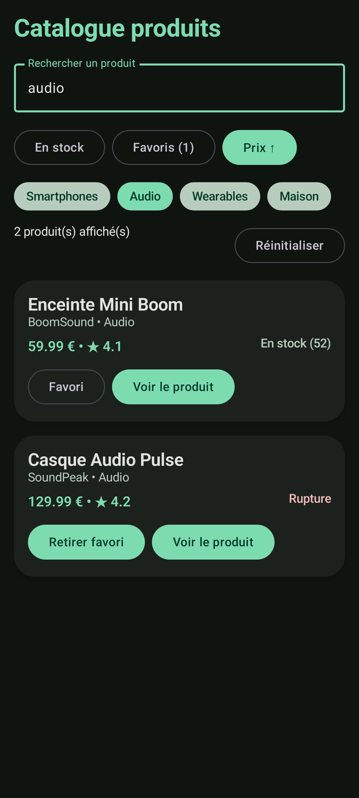

# Product Explorer – Projet fil rouge (TP 4 à TP 11)

Application Android développée avec Jetpack Compose dans le cadre des TP **Product Explorer** (TP 4 à TP 11), incluant les fonctionnalités supplémentaires réalisées en autonomie.

---

## Organisation du projet
- `MainActivity.kt` : point d'entrée Android lançant `ProductCatalogContainer`.
- `model/ProductUi.kt` : modèle de données local `ProductUi` et jeux de données (`sampleProduct`, `sampleProductOutOfStock`, `sampleProducts`, `sampleCategories`).
- `ui/catalog/ProductCatalogViewModel.kt` : `ViewModel`, `ProductCatalogUiState`, `PriceSortOrder` et gestion réactive de l'état via `StateFlow`.
- `ui/catalog/ProductCatalogScreen.kt` : `ProductCatalogContainer` (`collectAsState()`), `ProductCatalogScreen` (stateless), `CatalogFilterRow`, `CategoryRow`, `ProductListItem`, `EmptyCatalogCard` et previews clair/sombre.
- `ui/components/CategoryChip.kt` : puce de catégorie réutilisable (avec état sélectionné et clic optionnel).
- `ui/detail/ProductDetailScreen.kt` : écran détail produit (TP 4) et ses previews.
- `ui/home/ProductHomeScreen.kt` : écran d'accueil (TP 5) et sa preview.
- `ui/theme/` : thème Material Design 3 personnalisé (`LightColorScheme`, `DarkColorScheme`, `ProductTypography`, `ProductShapes`).

---

## Progression des TP réalisés

### Bloc 2 – Compose UI (TP 4 à TP 7)
- **TP 4** : écran de détail produit (`Text`, `Button`, `Icon`, `Image`, `Card`, `OutlinedTextField`).
- **TP 5** : écran d'accueil (`Column`, `Row`, `Box`, `Spacer`, `Surface`).
- **TP 6** : catalogue local avec listes modernes (`LazyColumn`, `LazyRow`, `items` avec `key`, `ProductListItem`).
- **TP 7** : personnalisation Material Design 3 (thème clair/sombre, typographie et formes).

### Bloc 3 – State Management & Architecture UI (TP 8 à TP 11)
- **TP 8** : catalogue interactif local (`remember`, `mutableStateOf`, `rememberSaveable`, recherche, filtre stock, favoris).
- **TP 9** : refactoring State Hoisting (`ProductCatalogContainer` stateful + `ProductCatalogScreen` stateless).
- **TP 10** : gestion de l'état dans `ProductCatalogViewModel` avec `lifecycle-viewmodel-compose`.
- **TP 11** : état unifié `ProductCatalogUiState` exposé par `StateFlow` (`MutableStateFlow` / `asStateFlow()` / `_uiState.update { it.copy(...) }`) et collecté dans Compose avec `collectAsState()`.

---

## Fonctionnalités supplémentaires (travail en autonomie)
Toutes les fonctionnalités ci-dessous sont entièrement intégrées à `ProductCatalogUiState` et au `StateFlow` du `ViewModel` :
1. **Filtre par catégorie cliquable** : cliquer sur un `CategoryChip` filtre le catalogue sur cette catégorie (et le met en évidence en couleur `primary`) ; un second clic réinitialise la catégorie.
2. **Filtre « Favoris uniquement »** : bouton dédié avec compteur dynamique de favoris (`Favoris (n)`). Si un produit est retiré des favoris alors que le filtre est actif, la liste se met à jour instantanément.
3. **Tri par prix** : bouton cyclique permettant de trier les produits affichés (*Prix : défaut* → *Prix ↑ croissant* → *Prix ↓ décroissant*).
4. **Indicateur de stock visuel** : affichage clair sur chaque `ProductListItem` (*En stock (x)* ou *Rupture*).
5. **État vide & réinitialisation des filtres** : affichage d'une carte `EmptyCatalogCard` lorsqu'aucun produit ne correspond, ainsi qu'un bouton *Réinitialiser* permettant de remettre tous les filtres à zéro en un clic.

---

## Aperçu (Previews TP 11)

### Catalogue – Thème clair

### Catalogue – Thème sombre (avec filtres catégorie + tri prix actifs)

