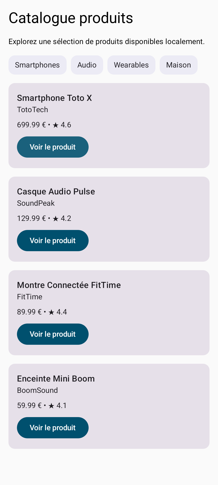

# Product Explorer - TP 4, TP 5 & TP 6

Application Android développée avec Jetpack Compose dans le cadre des **TP 4, TP 5 & TP 6 (Bloc 2 - Compose UI)**.

---

## TP 4 : Écran de détail produit (`ProductDetailScreen`)
Construire un premier écran complet de détail produit en utilisant les composants fondamentaux :
- `Text`, `Button`, `Icon`, `Image`, `Card`, `OutlinedTextField`.

---

## TP 5 : Écran d'accueil Product Explorer (`ProductHomeScreen`)
Construire un écran d'accueil assemblant différentes sections à l'aide des principaux layouts Compose :
- `Column`, `Row`, `Box`, `Spacer`, `Surface`.

---

## TP 6 : Affichage d'un catalogue local de produits (`ProductCatalogScreen`)
Afficher un catalogue local complet avec les listes modernes de Compose :
- `LazyColumn` : liste verticale performante avec `contentPadding` et `verticalArrangement = Arrangement.spacedBy(16.dp)`, combinant des éléments uniques (`item`) et une collection de produits (`items` avec `key = { it.id }`).
- `LazyRow` : ligne horizontale scrollable de catégories (`CategoryRow`) réutilisant le composable `CategoryChip`.
- `ProductListItem` : carte produit réutilisable (`Card`) affichant titre, marque, prix, note et bouton d'action.
- Données locales : ajout de l'identifiant `id` sur `ProductUi`, fonction `sampleProducts()` (4 produits) et `sampleCategories()`.

---

## Previews disponibles

### Catalogue produits (TP 6)

### Écran d'accueil (TP 5)
- `screenshots/preview_home.png`

### Écran de détail produit (TP 4)
- Produit standard en stock : `screenshots/preview_product.png`
- Produit hors stock : `screenshots/preview_outofstock.png`
