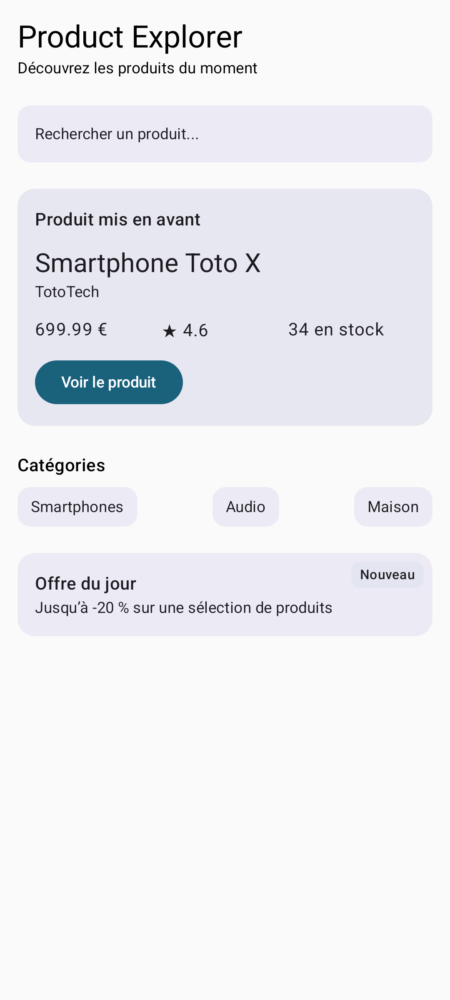

# Product Explorer - TP 4 & TP 5

Application Android développée avec Jetpack Compose dans le cadre des **TP 4 & TP 5 (Bloc 2 - Compose UI)**.

---

## TP 4 : Écran de détail produit (`ProductDetailScreen`)
Construire un premier écran complet de détail produit en utilisant les composants fondamentaux :
- `Text` : affichage des textes hiérarchisés avec la typographie `MaterialTheme`.
- `Button` : déclenchement de l'action "Ajouter au panier" via un callback (`() -> Unit`).
- `Icon` : icône étoile (`Icons.Default.Star`) alignée dans une `Row` pour la note produit.
- `Image` : affichage de l'image produit via un placeholder système (`android.R.drawable.ic_menu_gallery`).
- `Card` : cartes dédiées pour le prix/remise (`ProductPriceCard`) et la disponibilité/livraison (`ProductAvailabilityCard`).
- `TextField` : utilisation de `OutlinedTextField` en lecture seule pour afficher les informations de garantie.

---

## TP 5 : Écran d'accueil Product Explorer (`ProductHomeScreen`)
Construire un écran d'accueil assemblant différentes sections à l'aide des principaux layouts Compose :
- `Column` : organisation verticale générale de l'écran et des sections.
- `Row` : placement horizontal d'éléments (lignes d'infos rapides prix/note/stock, liste des catégories).
- `Box` : superposition d'éléments dans une même zone (bloc "Offre du jour" avec son badge "Nouveau" aligné en `TopEnd`).
- `Spacer` : contrôle propre des espacements verticaux fixes (`Modifier.height(...)`) et distribution horizontale dynamique (`Modifier.weight(1f)`).
- `Surface` : création de zones visuelles cohérentes avec le thème Material (barre de recherche factice, carte produit mis en avant, chips de catégories, badges).

### Composables de l'écran d'accueil :
- `HomeHeader` : titre et sous-titre d'accueil.
- `SearchPreviewBar` : zone visuelle simulant une barre de recherche.
- `FeaturedProductSection` : carte complète du produit vedette avec prix, note, stock et bouton d'action.
- `ProductQuickInfoRow` : affichage horizontal équilibré (`weight(1f)`) des infos du produit.
- `CategoryChip` & `CategoriesSection` : ligne de catégories réparties avec `Spacer(weight(1f))`.
- `DailyOfferBox` : bloc promotionnel avec badge superposé via `Box` et `align(Alignment.TopEnd)`.

---

## Previews disponibles

### Écran d'accueil (TP 5)

### Écran de détail produit (TP 4)
- Produit standard en stock : `screenshots/preview_product.png`
- Produit hors stock : `screenshots/preview_outofstock.png`
