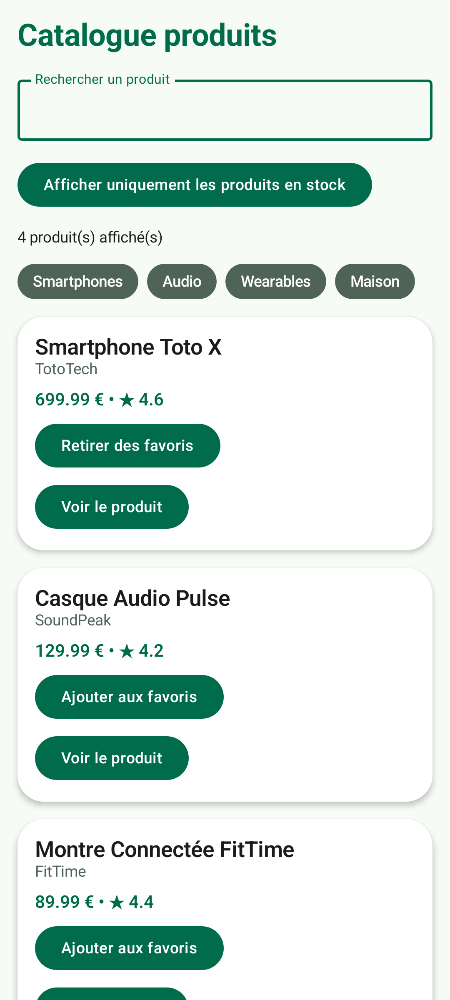

# Product Explorer - TP 4 à TP 10

Application Android développée avec Jetpack Compose dans le cadre des TP du cours Android Compose.

---

## Bloc 2 – Compose UI (TP 4 à TP 7)
- **TP 4 (`ProductDetailScreen`)** : composants fondamentaux (`Text`, `Button`, `Icon`, `Image`, `Card`, `OutlinedTextField`).
- **TP 5 (`ProductHomeScreen`)** : layouts Compose (`Column`, `Row`, `Box`, `Spacer`, `Surface`).
- **TP 6 (`ProductCatalogScreen`)** : listes modernes (`LazyColumn`, `LazyRow`, `items` avec `key`, `ProductListItem`).
- **TP 7 (Material Design 3)** : palettes clair/sombre (`LightColorScheme`, `DarkColorScheme`), `ProductTypography` et `ProductShapes`.

---

## Bloc 3 – State Management & Architecture UI (TP 8 à TP 10)
- **TP 8 (États Compose)** : ajout de la recherche interactive (`OutlinedTextField`), du filtre « produits en stock », du compteur de résultats et des favoris sur `ProductListItem` (`remember`, `mutableStateOf`, `rememberSaveable`).
- **TP 9 (State Hoisting)** : séparation entre le composable stateful `ProductCatalogContainer` (qui détient les états et la logique de filtrage) et le composable stateless `ProductCatalogScreen` (qui reçoit les valeurs et remonte les événements via callbacks).
- **TP 10 (ViewModel)** :
  - Ajout de `androidx.lifecycle:lifecycle-viewmodel-compose` via le Version Catalog.
  - Création de `ProductCatalogViewModel` contenant `allProducts`, `categories`, `searchQuery`, `showOnlyInStock`, `favoriteProductIds`, `filteredProducts` et les fonctions d'action (`onSearchQueryChange`, `onToggleStockFilter`, `onFavoriteClick`).
  - `ProductCatalogContainer` relie le `ViewModel` (`viewModel()`) à `ProductCatalogScreen`.
  - Previews stateless dédiées (`ProductCatalogScreenLightPreview` et `ProductCatalogScreenDarkPreview`).

---

## Previews disponibles

### Catalogue interactif - Thème clair (TP 10)

### Catalogue interactif - Thème sombre (TP 10)

